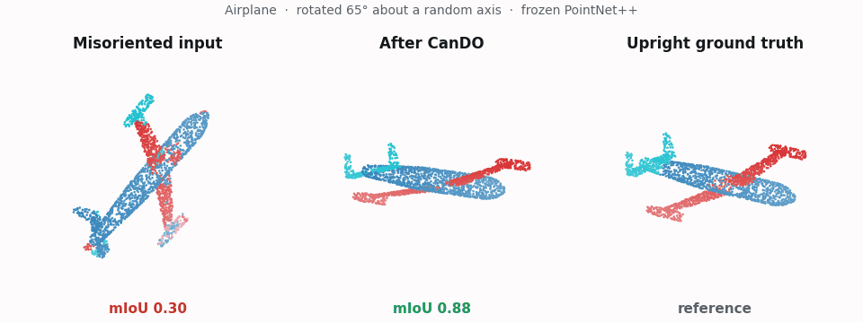

<div align="center">

<h1>CanDO (WACV 2027)</h1>

<h3>Recovering Black-Box Point Cloud Models from Pose Shifts<br>via Derivative-Free Optimization</h3>

<p>
<b>Seonghwan Park</b> &nbsp;·&nbsp; <b>Min-Gyu Park</b><br>
Korea Electronics Technology Institute (KETI)
</p>

<p>
<a href="https://shpark97.github.io/CanDO/"></a>
<a href="https://arxiv.org/abs/2610.34850"></a>
<a href="#-use-cando-on-your-own-model"></a>
</p>
<p>


</p>



</div>

> **TL;DR** &nbsp; A frozen point cloud model behind a score-only API collapses when inputs arrive in poses it never saw in
> training. **CanDO** (test-time **Can**onicalization via **D**erivative-free **O**ptimization) searches over input
> rotations with CMA-ES and keeps the one the model is most confident about, recovering much of the lost accuracy
> from forward queries alone.

<div align="center">
<table>
<tr>
<td align="center">🔒<br><b>Black-box</b><br><sub>no weights, gradients,<br>or internal statistics</sub></td>
<td align="center">🏷️<br><b>Label-free</b><br><sub>the model's own confidence<br>is the objective</sub></td>
<td align="center">🧩<br><b>Plug-in</b><br><sub>no retraining, no<br>auxiliary model</sub></td>
<td align="center">🌐<br><b>Global search</b><br><sub>CMA-ES over SO(3)<br>escapes local optima</sub></td>
</tr>
</table>
</div>

## 🔍 How it works

A rotation has only three degrees of freedom, so instead of touching the model's weights or the thousands of input
points, CanDO searches over the input's orientation:

1. **Propose.** CMA-ES samples a small population of candidate rotations.
2. **Query.** Each rotated copy of the input is sent through the frozen model once, and the candidate is scored by
   how confident the model is, i.e. its average maximum class probability over points (a single maximum for
   classification). No label or gradient is ever used.
3. **Adapt.** CMA-ES shifts its sampling distribution toward the most confident rotations and repeats.

After a budget of about 300 queries, CanDO keeps the most confident pose. The original orientation is always one of the
candidates, and an optional prior can keep inputs that are already upright untouched.
[Watch a real search unfold on the project page](https://shpark97.github.io/CanDO/#search).

## 📊 Results

<div align="center">

| Benchmark | Shift | Corrupted | **CanDO** | Oracle | Gap closed |
|:--:|:--:|:--:|:--:|:--:|:--:|
| ShapeNetPart | Azimuth | 0.387 | **0.752** | 0.869 | **76%** |
| ShapeNetPart | SO(3) | 0.352 | **0.602** | 0.845 | **51%** |
| S3DIS | Tilt | 0.305 | **0.528** | 0.735 | **52%** |
| ModelNet40 | SO(3) | 0.125 | **0.340** | 0.861 | **29%** |

<sub>Frozen PointNet++, full test sets, mean of three corruption seeds (mIoU; accuracy for ModelNet40). PointNeXt-S
results and every baseline are in the paper and on the <a href="https://shpark97.github.io/CanDO/">project page</a>.</sub>

</div>

CanDO beats every forward-only baseline. Parameter-space test-time adaptation (TENT, MEMO, DUA) cannot undo a pose
change, and even white-box gradient ascent on the rotation stalls at 0.500 mIoU on ShapeNetPart, trapped in the
multi-modal confidence landscape that CanDO's global search escapes.

## 🚀 Use CanDO on your own model

The `cando` package depends only on PyTorch, NumPy, and [pycma](https://github.com/CMA-ES/pycma):

```bash
pip install git+https://github.com/shpark97/CanDO.git
```

Your model stays a black box. Write an `objective` that rotates the input by a batch of candidate rotations, queries
the model once per candidate, and returns its confidence:

```python
from cando import cando, max_prob_confidence, rotate

points = ...                                        # (N, 3) misoriented input, row vectors
frozen_model = ...                                  # any callable returning class probabilities

def objective(Rs):                                  # Rs: (M, 3, 3) candidate rotations
    probs = frozen_model(rotate(points, Rs))        # (M, C) for classification, (M, N, C) for segmentation
    return max_prob_confidence(probs)               # (mean) maximum probability, shape (M,)

R, theta, info = cando(objective, budget=300)       # CMA-ES: population 10, sigma0 1.2, 2 restarts
prediction = frozen_model(rotate(points, R)[None])  # predict in the canonicalized frame
```

<details>
<summary><b>Arguments and return values</b></summary>

| Argument | Default | Meaning |
|---|---|---|
| `budget` | `300` | total forward queries per input, the identity included |
| `popsize` | `10` | rotations scored per batched call (one CMA-ES generation) |
| `sigma0` | `1.2` | initial CMA-ES step size in radians |
| `restarts` | `2` | independent CMA-ES runs sharing the budget |
| `lam` | `0.0` | identity-prior weight; `lam > 0` keeps already-upright inputs unchanged unless another pose is clearly more confident |
| `device` | auto | device of the rotation matrices passed to `objective` |

`cando` returns the selected rotation matrix `R`, its axis-angle vector `theta`, and
`info = {"confidence", "queries"}`. If the model expects normals or other geometric channels, rotate them with the
same `R`. Segmentation predictions made in the rotated frame are per point, so they map back to the original points
directly.

</details>

### Examples

```bash
pip install -e .                                       # from a clone of this repository
python examples/quickstart.py                          # toy black box, CPU only, a few seconds
PYTHONPATH=. python examples/modelnet40_demo.py --n 20 # frozen PointNet++ on ModelNet40 (needs the setup below)
python -m pytest tests                                 # unit tests (CPU)
```

`quickstart.py` misorients a synthetic object by about 137° and recovers it to within a few degrees from confidence
queries alone. `modelnet40_demo.py` wraps the released PointNet++ ModelNet40 classifier as a score-only black box and
raises its accuracy under random SO(3) rotations (0.05 → 0.30 on the default 20 shapes).

## 🧪 Reproducing the paper

Everything below is only needed to rerun the paper's experiments.

<details>
<summary><b>Installation</b></summary>

The paper experiments need the third-party backbones and datasets below. Tested on Ubuntu with Python 3.10, PyTorch 2.4.1 + CUDA 12.1, and one RTX A6000.

```bash
conda create -n cando python=3.10 -y && conda activate cando
pip install torch==2.4.1 torchvision==0.19.1 --index-url https://download.pytorch.org/whl/cu121
pip install torch-cluster -f https://data.pyg.org/whl/torch-2.4.1+cu121.html
pip install -r requirements.txt
pip install -e .                       # the cando package

# third-party model code at the exact commits we used (+ our small vnn patch)
bash scripts/setup_third_party.sh

# PointNeXt backbones need the openpoints CUDA ops
cd third_party/PointNeXt/openpoints/cpp/pointnet2_batch && python setup.py install && cd -
```

</details>

<details>
<summary><b>Data</b></summary>

Place the datasets under `datasets/`:

```
datasets/
├── shapenetcore_partanno_segmentation_benchmark_v0_normal/   # ShapeNetPart (x y z nx ny nz label per row)
├── modelnet_dl/                                              # ModelNet40, modelnet40_normal_resampled format
│   ├── modelnet40_shape_names.txt, modelnet40_test.txt, airplane/, ...
└── s3dis/                                                    # S3DIS in Pointcept format
    └── Area_5/<room>/{coord,color,normal,segment}.npy
```

| Dataset | Source | Notes |
|---|---|---|
| ShapeNetPart [(Yi et al., 2016)](https://cs.stanford.edu/~ericyi/project_page/part_annotation/) | [PointNet++ preprocessed version](https://shapenet.cs.stanford.edu/media/shapenetcore_partanno_segmentation_benchmark_v0_normal.zip) ([Google Drive mirror](https://drive.google.com/file/d/1W3SEE-dY1sxvlECcOwWSDYemwHEUbJIS)) | `shapenetcore_partanno_segmentation_benchmark_v0_normal`, from [PointNet++](https://github.com/charlesq34/pointnet2) |
| ModelNet40 [(Wu et al., 2015)](https://modelnet.cs.princeton.edu/) | [modelnet40_normal_resampled.zip](https://shapenet.cs.stanford.edu/media/modelnet40_normal_resampled.zip) | 10k points with normals per shape, from [PointNet++](https://github.com/charlesq34/pointnet2); rename the folder to `datasets/modelnet_dl` |
| S3DIS [(Armeni et al., 2016)](http://buildingparser.stanford.edu/dataset.html) | [Pointcept](https://github.com/Pointcept/Pointcept) preprocessing (`preprocess_s3dis.py --parse_normal`) or the [preprocessed release](https://huggingface.co/datasets/Pointcept/s3dis-compressed) | per-room `coord/color/normal/segment.npy`; Area 5 is the test split |
| ModelNet-C / ShapeNet-C [(Ren et al., 2022)](https://github.com/ldkong1205/PointCloud-C) | none | generated on the fly with the official PointCloud-C corruption functions (`third_party/PointCloud-C/build`) |

</details>

<details>
<summary><b>Checkpoints</b></summary>

All models are used frozen. Checkpoints released by other projects:

| Model | Source | Path |
|---|---|---|
| PointNet++ (ShapeNetPart, S3DIS, ModelNet40) | [Pointnet_Pointnet2_pytorch](https://github.com/yanx27/Pointnet_Pointnet2_pytorch), downloaded by `scripts/setup_third_party.sh` | `third_party/Pointnet_Pointnet2_pytorch/log/` |
| PointNeXt-S S3DIS | [PointNeXt model zoo](https://guochengqian.github.io/PointNeXt/modelzoo/) (S3DIS, PointNeXt-S) | `pretrained/pointnext_s3dis/checkpoint/*_ckpt_best.pth` |

Checkpoints we trained are bundled in **`checkpoints.zip`** (97 MB,
[Google Drive](https://drive.google.com/file/d/10QP02do8qwMdOyLbvoyIvbSkzZGfcRrG/view?usp=drive_link)).
Download and unzip it at the repository root:

```bash
curl -L "https://drive.usercontent.google.com/download?id=10QP02do8qwMdOyLbvoyIvbSkzZGfcRrG&export=download&confirm=t" \
     -o checkpoints.zip       # or: pip install gdown && gdown 10QP02do8qwMdOyLbvoyIvbSkzZGfcRrG
sha256sum checkpoints.zip     # 7f3f44f860ab4760b016094d6010f8f3c7613195c276d81c90c16dd5b9483c27
unzip checkpoints.zip
```

This creates:

| Model | Used in | Path |
|---|---|---|
| PointNeXt-S ShapeNetPart | Table 1 | `pretrained/pointnext_shapenetpart/best.pth` |
| PointNeXt-S ModelNet40 | Table 1 | `pretrained/pointnext_modelnet/best_model.pth` |
| PointNet++ ShapeNetPart with rotation augmentation none / yaw / tilt / so3 | Table 4 | `pretrained/pointnet2_partseg_aug/{none,yaw,tilt,so3}/best_model.pth` |
| VN-PointNet / VN-DGCNN ShapeNetPart | Table 9 | `pretrained/vn_{pointnet,dgcnn}_partseg/best_model.pth` |

To retrain them instead:

```bash
# PointNeXt-S ShapeNetPart: official PointNeXt recipe (third_party/PointNeXt/cfgs/shapenetpart/pointnext-s.yaml)
# PointNeXt-S ModelNet40 classifier (no rotation augmentation)
PYTHONPATH=third_party/PointNeXt:. python scripts/train_pointnext_cls.py --epochs 300
# PointNet++ ShapeNetPart with rotation augmentation none / yaw / tilt / so3
PYTHONPATH=. python -m src.eval.train_partseg_aug --rot_aug none --epochs 100 \
    --out pretrained/pointnet2_partseg_aug/none/best_model.pth
# Vector Neurons part segmentation (aligned training); the vnn code reads data/ inside its own folder
ln -s ../../../datasets/shapenetcore_partanno_segmentation_benchmark_v0_normal third_party/vnn/data/
cd third_party/vnn && python train_partseg.py --model vn_pointnet_partseg --rot aligned --log_dir vn_pointnet_partseg
```

</details>

<details>
<summary><b>Commands for Tables 1-9</b></summary>

This release covers the main-paper experiments (Tables 1-9). Run every command from the repository root.
Scripts print their results; `--dump` writes per-shape JSON to `runs/`. Experiments that use PointNeXt
need `PYTHONPATH=third_party/PointNeXt:.` instead of `PYTHONPATH=.`.

#### Multi-GPU sharding and seeds

Full-test-set experiments accept `--idx_start/--idx_end/--dump`. Per-shape randomness is keyed by the
global shape index, so any split reproduces the single-process numbers exactly. `--cseed {0,1,2}`
selects the corruption seed; Table 1 reports mean ± std over the three seeds. Example with 8 GPUs:

```bash
N=2874; S=$(( (N + 7) / 8 ))           # 2874 ShapeNetPart test shapes (2468 for ModelNet40)
for cs in 0 1 2; do
  for g in 0 1 2 3 4 5 6 7; do
    CUDA_VISIBLE_DEVICES=$g PYTHONPATH=. python -m src.eval.baseline_compare_partseg --fast --n -1 \
      --cseed $cs --idx_start $((g*S)) --idx_end $(((g+1)*S)) --dump runs/s3_partseg_c${cs}_g${g}.json &
  done; wait
done
```

#### Tables 1-9

| Result | Command |
|---|---|
| **Table 1**, PointNet++ ShapeNetPart SO(3) | `baseline_compare_partseg --fast --n -1 --cseed {0,1,2}`, sharded as above, dumps `runs/s3_partseg_c*_g*.json` |
| **Table 1**, PointNet++ ShapeNetPart azimuth | `baseline_azimuth --n -1 --cseed {0,1,2}`, dumps `runs/s3_azimuth_c*_g*.json` |
| **Table 1**, PointNet++ ModelNet40 SO(3) | `canon_modelnet --n -1 --Moracle 256 --cseed {0,1,2}`, dumps `runs/s3_cls_c*_g*.json` |
| **Table 1**, PointNeXt-S ShapeNetPart | `NGPU=8 bash scripts/run_pnx_partseg_recovery.sh` |
| **Table 1**, PointNeXt-S ModelNet40 | `canon_modelnet --backbone pointnext --n -1 --cseed {0,1,2} --dump runs/mn_pnx_c{cs}.json` |
| **Table 1**, aggregation of the rows above | `python -m src.eval.agg_seed3` |
| **Table 1**, S3DIS tilt | `canon_s3dis_tilt_seeds --n_blocks 48 --seeds 0 1 2` (PointNet++), `canon_s3dis_tilt_pointnext --n_blocks 48 --seeds 0 1 2` (PointNeXt-S) |
| **Table 2**, ShapeNetPart | `baseline_compare_partseg --n -1` → `aggregate_compare runs/cmpshard_*.json`; DUA and gradient-based: `baseline_tta_extra` → `aggregate_json "TTA" clean,corrupt,dua,gradcanon runs/tta_*.json`; external prior: `baseline_external_prior` → `aggregate_json "ext" clean,corrupt,extprior,ours,oracle runs/extp_*.json` |
| **Table 2**, S3DIS | `baseline_compare_s3dis --n 300` (sharded) → `aggregate_compare_s3dis runs/s3dis_cmpshard_*.json` |
| **Table 2**, ModelNet40 | `baseline_memo --n -1` (source, TENT, MEMO, ours); `baseline_cls_extra --n -1` (PCA variants); `baseline_tta_cls --n -1` (DUA, gradient-based) → `aggregate_json` |
| **Table 3** | `canon_s3dis_rooms --n_blocks 48`; tilt row from `canon_s3dis_tilt_seeds`; cross-architecture probe `cross_arch_auggap --n_blocks 48` |
| **Table 4** | `train_partseg_aug --rot_aug {none,yaw,tilt,so3}`, then `eval_partseg_aug --ckpt pretrained/pointnet2_partseg_aug/<aug>/best_model.pth --corrupt {yaw,tilt,so3} --n 2874 --dump runs/psaug/eval_<aug>_<corrupt>.json` |
| **Table 5** | `estimator_ablation --n 48` |
| **Table 6** | `bo_query_efficiency --n 48` |
| **Table 7**, classification | `modelnet_c --n -1 --lam 0.4` |
| **Table 7**, part segmentation | `shapenet_c_full --n 512` |
| **Table 8** | `modelnet_c --n -1 --lam 0.4` (confidence) and `modelnet_c --gate margent` (marginal entropy) |
| **Table 9** | `vn_partseg_noop --model {vn_pointnet_partseg,vn_dgcnn_partseg} --ckpt pretrained/<model>/best_model.pth --n -1` |

Every module above is run as `PYTHONPATH=. python -m src.eval.<module> <args>`.

</details>

<details>
<summary><b>Repository layout</b></summary>

```
cando/                  # pip-installable, model-agnostic CanDO (Algorithm 1)
examples/               # quickstart (toy, CPU) and frozen PointNet++ ModelNet40 demo
tests/                  # unit tests for the cando package
docs/                   # project page (GitHub Pages)
src/                    # code behind the paper's tables
├── zoo/                # rotation parameterization, CMA-ES and local DFO estimators
├── data/               # ShapeNetPart, ModelNet40, S3DIS loaders; PointCloud-C corruptions
├── downstream/         # frozen black-box wrappers (PointNet++, PointNeXt-S)
├── samplers/           # farthest point sampling used to build S3DIS blocks
└── eval/               # one script per experiment (see tables above) and result aggregators
scripts/                # third-party setup, multi-GPU launcher, training, project-page assets
patches/                # local modifications to third-party code
```

</details>

## 📝 Citation

```bibtex
@inproceedings{park2027cando,
  title     = {Recovering Black-Box Point Cloud Models from Pose Shifts via Derivative-Free Optimization},
  author    = {Park, Seonghwan and Park, Min-Gyu},
  booktitle = {Proceedings of the IEEE/CVF Winter Conference on Applications of Computer Vision (WACV)},
  year      = {2027}
}
```

## 🙏 Acknowledgements

This code builds on [Pointnet_Pointnet2_pytorch](https://github.com/yanx27/Pointnet_Pointnet2_pytorch),
[PointNeXt](https://github.com/guochengqian/PointNeXt), [Vector Neurons](https://github.com/FlyingGiraffe/vnn),
[PointCloud-C](https://github.com/ldkong1205/PointCloud-C),
and [pycma](https://github.com/CMA-ES/pycma).
